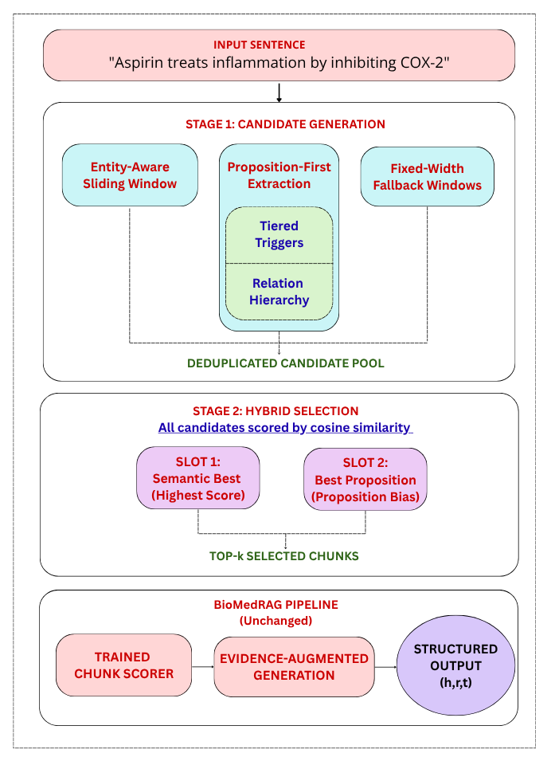

# Configurable Semantic Chunking for Biomedical Retrieval-Augmented Generation

Code for the article **"Configurable Semantic Chunking for Biomedical Information Extraction in Retrieval-Augmented Generation"** (Ahuja, Kacprowski, Shiasi Sardoabi).

- Preprint: [arXiv:2608.31139](https://arxiv.org/abs/2608.31139)
- Large precomputed files (embeddings, generated data): Zenodo record in preparation; the link will be added here.
- Built on [BiomedRAG](https://github.com/ToneLi/BIoMedRAG) (Li et al.)

## 1) Overview

BiomedRAG retrieves evidence for an input sentence by splitting it into fixed windows of five words, scoring the chunks with a learned chunk scorer, and passing the selected chunks to an LLM that generates the output (triples or labels). Fixed windows can fragment multi-token entities and separate a relation trigger from the arguments it connects.

This repository replaces **only the chunk-construction stage** with a configurable semantic chunking framework. The embedding model, chunk scorer, generator, preprocessing and evaluation protocol are the same as in BiomedRAG, so the workflow below follows the original code structure.



The chunking framework combines:

- **Entity-preserving sliding windows**: windows never cut through a detected entity.
- **Trigger-centered chunking** with **tiered trigger prioritization**: chunks are built around relation trigger words, ordered by tier.
- **Relation hierarchy resolution**: when several relations match, a configured hierarchy decides which one wins.
- **Proposition-first extraction**: minimal subject-trigger-object spans are extracted first.
- **Fixed-window fallback** when no semantic chunk is found.

Candidates from all sources are ranked by cosine similarity to the target relation definition, with a bias toward structurally complete (proposition) spans. All dataset-specific knowledge (trigger vocabularies, tier assignments, relation hierarchies, window parameters) lives in **JSON configuration files**, so adapting the chunker to a new relation set does not require code changes.

Evaluated on **GM-CIHT**, **DDI** and **ChemProt** (triple extraction) and **ADE** (binary classification), with component-wise ablations on GM-CIHT.

## 2) Repository structure

| Folder | Contents |
|---|---|
| `Fixed_Pipeline/` | BiomedRAG baseline with fixed 5-word windows. `GM_CHIT_FIXED_PIPELINE/`, `Chemprot_fixed/`, `DDI_Fixed/`, `ADE_FIXED/` hold the numbered data-preparation scripts per dataset. |
| `Entity_aware_semantic/` | Entity-aware semantic chunking variant (scripts with the `_improved` suffix). |
| `Hybrid_pipeline/` | **Full configurable chunker.** `configurable_semantic_chunker.py`, `proposition_chunker.py`, `configs/` (JSON configurations), and per-dataset folders `gm_chit/`, `chemprot/`, `ddi/` with the numbered `hybrid_*` scripts. |
| `Ablation Studies/` | Ablation variants on GM-CIHT: semantic propositions, tiered chunking, hybrid with scoring, hybrid with NER. |
| `Chunk_scorer/` | Chunk scorer: modified `transformers` files (`trainer.py`, `ChuckWeights.py`, `SplitInputsChunks.py`, ...), scorer data creation and `apply_chunk_scorer_integration.py`. |
| `Triple_trainer/` | LLM fine-tuning with the chunk scorer (`trainer_withChunkScorer_*.py`). |
| `Generation/` | Generation (`chuck5_generation_*.py`) and F1 evaluation (`0_F1_triplet_evalution_*.py`) scripts, plus saved evaluation results (`F1_EVALUATION_*.json/.txt`). Subfolders `hybrid/` and `ablation/`. |
| `Miscellaneous/` | Development and legacy scripts, SLURM job files (`slurm/`), KNN demo-set builders. Kept for transparency; not needed for the main pipeline. |

## 3) Configuration files

The configurations are in `Hybrid_pipeline/configs/`:

| File | Used for |
|---|---|
| `gmciht_config.json` | GM-CIHT |
| `ddi_config.json` | DDI |
| `chemprot_config.json`, `chemprot_config_improved.json` | ChemProt |
| `ade_config.json` | ADE |
| `ablation/gmciht_config_*.json` | One file per ablation step on GM-CIHT: `fixed`, `semantic_only`, `semantic_prop`, `semantic_prop_hierarchy`, `semantic_prop_tiered`, `hybrid_full` |

Each configuration defines:

- **Trigger lexicons**: relation type to trigger words
- **Tiered trigger definitions**: primary, secondary and tertiary triggers per relation type
- **Relation hierarchy**: a base priority for every relation type
- **Negation rules**: negation markers and relation-flipping mappings
- **Chunking parameters**: window size, stride, and minimum/maximum chunk length

To use the chunker on a new dataset, copy an existing configuration, edit these entries, and point the scripts of your dataset folder at the new file.

Entity-aware window parameters used in the article, selected per dataset by grid search on the development set (the JSON files are authoritative):

| Dataset | Window | Stride | Min length | Max length |
|---|---|---|---|---|
| GM-CIHT | 8 | 3 | 5 | 12 |
| DDI | 6 | 2 | 4 | 9 |
| ChemProt | 5 | 2 | 3 | 10 |
| ADE | 7 | 3 | 5 | 15 |

Fixed for all datasets: trigger-centered windows of up to 9 words (4 words on each side of the trigger), proposition spans of at most 25 tokens expanded by 3 tokens on each side, proposition bias over the top 5 candidates, and the top 2 chunks selected per sentence.

## 4) Environment

The environment is the one of BiomedRAG:

- Python 3.8
- `transformers==4.31.0`
- PyTorch with CUDA, `bitsandbytes` (the 13B models are loaded in quantized form), `numpy`
- BiomedRAG used A100 GPUs. Our experiments ran on NVIDIA A40 GPUs (44 GB) with 4-bit NF4 quantization.

The chunk scorer uses modified `transformers` source files. As in BiomedRAG, install `transformers` from source and copy the files from `Chunk_scorer/transformers/` over/into the corresponding location of your installation (replace `trainer.py`, add `SplitInputsChunks.py` and `ChuckWeights.py`).

Models used in our experiments:

- **Embeddings:** [MedLLaMA-13B](https://huggingface.co/chaoyi-wu/MedLLaMA_13B) (Wu et al., 2023) for chunks and relation definitions, maximum input length 512 tokens, mean pooling over the token-level hidden states.
- **Chunk scorer:** initialized from Llama-2-13B and trained with LoRA (rank 8, alpha 8, dropout 0.1) for 1,000 steps with AdamW in bfloat16. One scorer is trained per dataset. Because of GPU memory (44 GB A40 instead of 80 GB A100) we used `max_seq_length=1024` instead of the 4098 used in BiomedRAG.
- **Generator:** unchanged from BiomedRAG.

Model and data paths are set at the top of each script, either through a `MODEL_ID` constant or as absolute paths from our cluster (for example `/home/users/riah/models/MedLLaMA_13B`). Replace them with your own locations. Model weights are not part of this repository.

## 5) Data

The datasets are **not redistributed**. Obtain them from their original sources and respect their licenses:

| Dataset | Task | Relation types | Train / Dev / Test | Source |
|---|---|---|---|---|
| GM-CIHT | Triple extraction | 22 | 3,734 / 492 / 465 | [Li et al., 2024](https://arxiv.org/abs/2310.18463); data in the `dataset` folder of the [BiomedRAG repository](https://github.com/ToneLi/BIoMedRAG) |
| DDI | Triple extraction | 4 | 1,027 / 258 / 1,094 | [SemEval-2013 Task 9](https://aclanthology.org/S13-2056/) (instances labeled "none" excluded) |
| ChemProt | Triple extraction | 5 | 4,111 / 2,411 / 3,438 | BioCreative VI CHEMPROT track (Krallinger et al., 2017) |
| ADE | Relation classification | 2 | 4,000 / 975 / 497 | [ADE corpus](https://doi.org/10.1016/j.jbi.2012.04.008) (Gurulingappa et al., 2012) |

All datasets are converted to one unified JSONL format (one record per line). For ADE, the source `text` and `label` fields are mapped to this format during preprocessing.

```
{"PREDICATE": "INTERACTS_WITH",
 "SUBJECT_TEXT": "nalorphine",
 "OBJECT_TEXT": "morphine",
 "SENTENCE": "[on the effect of respiration of a combination of  morphine -like acting pethidine with the  morphine  antagonist  nalorphine ]."}
```

Edit the input and output paths at the top of the scripts to match your setup. Many were written for a SLURM cluster (`*.slurm` files show the job settings we used).

### Precomputed files

Embedding vectors (`.npy`), candidate databases and large generated files (training/test instruction files, top-n outputs) are too large for GitHub and will be made available on Zenodo (link to follow). Once available:

```bash
tar -xf zenodo_embeddings.tar
tar -xzf zenodo_generated_outputs.tar.gz
```

Extract both archives into the root of this repository; they keep the folder structure. Small result files (for example `Generation/**/F1_EVALUATION_*`) are already included here.

## 6) How to run

The workflow has the same six stages as BiomedRAG. Run the numbered scripts of a folder in order of their numbers, updating file names and locations as needed. The example below uses the full hybrid pipeline on GM-CIHT.

**Step 1: Build chunk database and scorer data** (`Hybrid_pipeline/gm_chit/`)

```bash
cd Hybrid_pipeline/gm_chit
CUDA_VISIBLE_DEVICES=0 python hybrid_0_relation_embedding.py
CUDA_VISIBLE_DEVICES=0 python hybrid_1_chunk_mapping.py
CUDA_VISIBLE_DEVICES=0 python hybrid_1b_store_embeddings.py
CUDA_VISIBLE_DEVICES=0 python hybrid_2_make_train_chunks.py
CUDA_VISIBLE_DEVICES=0 python hybrid_2_make_test_chunks.py
CUDA_VISIBLE_DEVICES=0 python hybrid_3_make_topn_scored.py
CUDA_VISIBLE_DEVICES=0 python hybrid_4_make_candidate_embeddings.py
CUDA_VISIBLE_DEVICES=0 python hybrid_5_instruction_scored.py
```

Large embedding steps can be run in shards (see the `*.slurm` files) and merged with the shard-merging scripts (for example `merge_hybrid_shards.py`). The ChemProt and DDI folders (`Hybrid_pipeline/chemprot/`, `Hybrid_pipeline/ddi/`) contain the dataset-specific versions of these steps, used with their own configuration files. The fixed-window baseline is built the same way with the scripts in `Fixed_Pipeline/<dataset folder>/`.

**Step 2: Train and apply the chunk scorer** (`Chunk_scorer/`)

Train one scorer per dataset on the scorer data created in step 1, with the settings in section 4, using the modified `transformers` files described in section 4. The trained scorer is then applied to the training and test candidates (see `apply_chunk_scorer_integration.py` and the scorer-data scripts in this folder) to select the chunks passed to the LLM.

**Step 3: Fine-tune the LLM for triple extraction** (`Triple_trainer/`)

```bash
cd Triple_trainer
CUDA_VISIBLE_DEVICES=0 python trainer_withChunkScorer_hybrid_s_hrt.py
```

**Step 4: Generate triples** (`Generation/hybrid/`)

```bash
cd Generation/hybrid
CUDA_VISIBLE_DEVICES=0 python chuck5_generation_hybrid_s_hrt_10000.py
```

The number in the file name (`8000` or `10000`) is the training checkpoint step used for generation.

**Step 5: Evaluate**

```bash
python 0_F1_triplet_evalution_hybrid_s_hrt_10000.py
```

Scripts for the fixed baseline, the entity-aware variant and the ablations are in `Generation/` and `Generation/ablation/`, with matching names.

## 7) Results

Micro-averaged F1 as reported in the article. The effect of the chunking strategy depends on the dataset.

| Dataset | Fixed windows (BiomedRAG) | Configurable semantic chunking |
|---|---|---|
| GM-CIHT | 74.2 | **82.6** |
| DDI | 78.2 | **79.2** |
| ChemProt | **87.4** | 86.6 |
| ADE | **88.8** | 87.3 |

Our fixed baseline reproduces below the originally published BiomedRAG figure on GM-CIHT (74.2 versus 81.42 F1). Likely contributing factors are the shorter scorer sequence length forced by GPU memory (1024 versus 4098), the scorer integration code, which BiomedRAG does not release and which we implemented from the paper, and our dataset-specific preprocessing for DDI, ChemProt and ADE. Both conditions here use the same hardware, preprocessing, scorer training, generation and evaluation settings, so the differences reflect chunk construction. See the article for the ablation study and discussion.

## 8) Citation

If you use this code or data, please cite the article:

```bibtex
@misc{ahuja2026configurable,
  title         = {Configurable Semantic Chunking for Biomedical Information Extraction in Retrieval-Augmented Generation},
  author        = {Ahuja, Riya and Kacprowski, Tim and Shiasi Sardoabi, Roya},
  year          = {2026},
  eprint        = {2608.31139},
  archivePrefix = {arXiv}
}
```

Please also cite BiomedRAG (Li et al.), on which this work builds.

## 9) Acknowledgements

GPU resources for the experiments were funded by the German Research Foundation (Deutsche Forschungsgemeinschaft, DFG), grant number 527049502. This work builds on BiomedRAG (Li et al.).
